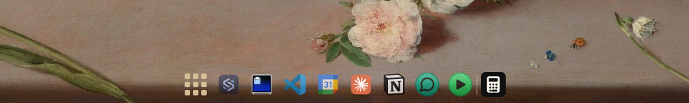

# Tiling Dock for Omarchy

Omarchy 4.5 ships an app dock, but it only appears on **floating** workspaces.
Tiling Dock is a drop-in replacement for it that shows up on **every** workspace,
tiled or floating, and lays out your apps the way the macOS Dock does.



## Features

- **Works in tiling mode.** The dock is shown on every workspace, whatever its
  layout (dwindle, scrolling or floating). It still hides behind fullscreen windows.
- **Pinned apps first, macOS-style.** Your pinned apps always sit on the left, in
  the order you pinned them. Apps that are open but not pinned show up on the
  right, after a separator.
- **Smart auto-hide.** With auto-hide on, the dock stays visible on an empty
  workspace and tucks away only once an app is open there. Push the pointer to
  the screen edge to bring it back.
- **Optional macOS-style background.** Put a frosted-glass or solid panel behind
  the icons, so the dock stays readable on busy wallpapers. The panel takes the
  bar's color, so it follows your theme.
- **Everything else from the stock dock still works.** You can drag to reorder,
  pin and unpin from the right-click menu, open the app grid, restore minimized
  windows, use any of the four positions, and see running indicators.

## Install

Requires **Omarchy 4.5 or later**.

```bash
omarchy plugin add https://github.com/gusmezomo/omarchy-tiling-dock --enable
```

That's it. Enabling Tiling Dock turns off the built-in `omarchy.dock` for you, so
you won't end up with two docks.

> Plugins run unsandboxed inside the Omarchy shell. As with any plugin, read the
> code before you install it.

## Configure

Tiling Dock reads the same `dock` settings as the built-in dock, so the stock
commands work:

```bash
omarchy dock position bottom      # top | bottom | left | right
omarchy dock autohide on          # on | off | toggle
omarchy dock pin org.gnome.Nautilus
omarchy dock unpin org.gnome.Nautilus
```

Or edit `~/.config/omarchy/shell.json` directly:

```json
"dock": {
  "position": "bottom",
  "autohide": true,
  "pinned": ["org.gnome.Nautilus", "chromium", "com.mitchellh.ghostty"]
}
```

Pinned entries are desktop file ids (the `.desktop` file name without the extension).

### Background

The panel behind the icons can be one of three styles:

| Value | Look |
|---|---|
| `none` | No panel, the icons sit straight on the wallpaper (the default) |
| `glassy` | A see-through panel that blurs the wallpaper behind it, like the macOS Dock |
| `opaque` | A solid panel in the bar's color |

Pick one from the dock itself: right-click the apps button (the grid at the
start of the dock) and choose **No Background**, **Glassy Background** or
**Opaque Background**. You can also set `"background"` in the `dock` section of
`~/.config/omarchy/shell.json`, or use the script that ships with the plugin:

```bash
~/.config/omarchy/plugins/gusmezomo.dock/dock-background glassy   # none | glassy | opaque | cycle
```

#### Glass opacity

`glassOpacity` sets how much of the panel's color shows in glassy mode, from `0`
to `100`. Lower is more see-through; the default is `40`.

```json
"dock": { "background": "glassy", "glassOpacity": 20 }
```

```bash
~/.config/omarchy/plugins/gusmezomo.dock/dock-background opacity 20
```

#### What glassy changes on your system

The dock can draw a see-through panel, but only Hyprland can blur what is behind
it, and it only does that when a layer rule asks for it. So while the dock is
glassy, Tiling Dock keeps this file in Omarchy's toggles folder, next to the one
the Glassy bar uses:

```
~/.local/state/omarchy/toggles/hypr/dock-glassy.lua
```

It is written when you pick glassy and removed when you pick another style, and
Hyprland's config is reloaded each time. The dock checks it whenever it loads, so
a style set by editing `shell.json` gets its blur too. Nothing in
`~/.config/hypr` is changed.

The file does two things:

- **Turns on Hyprland's blur.** Omarchy ships with blur off and only turns it on
  for the Glassy bar or Glassy windows. The dock uses the same blur settings, so
  it looks the same as a glassy bar. Blur strength is one setting for the whole
  system, so the dock can't have a stronger or weaker blur of its own.
- **Blurs behind the dock's panel only.** The rule matches the `omarchy-dock`
  layer, and `ignore_alpha` keeps the fully clear area around the panel
  unblurred, whatever the glass opacity.

If you'd rather manage the blur yourself, add this to your Hyprland config. It
is the same rule the file holds:

```lua
require("default.hypr.glass")()

hl.layer_rule({
  match = { namespace = "^omarchy-dock$" },
  blur = true,
  ignore_alpha = 0.01,
})
```

Without the rule, glassy still draws the see-through panel, just without the
blur.

## Update

```bash
omarchy plugin update gusmezomo.dock
omarchy restart shell
```

## Uninstall

```bash
omarchy plugin disable gusmezomo.dock   # switches the built-in dock back on
omarchy plugin remove gusmezomo.dock
```

A removed plugin can't clean up after itself. If you used the glassy background,
switch it off before removing the plugin, or delete the blur rule afterwards:

```bash
rm -f ~/.local/state/omarchy/toggles/hypr/dock-glassy.lua && hyprctl reload
```

## How it works

Tiling Dock started as a copy of the built-in dock made with
`omarchy plugin clone omarchy.dock`. The first commit in this repository is that
unmodified copy, so `git diff <first-commit>` shows every change made on top of
it. The changes are:

- `DockWindow.qml` no longer needs the workspace to be floating to show the dock.
  Auto-hide only applies when the active workspace has windows. It also draws
  the separator between pinned and running apps, the optional background panel
  and its menu entries, and fades idle pinned apps less (85% instead of 70%).
- `Dock.qml` always lists pinned apps first, in pin order, and the running apps
  after them. It reads the dock settings straight from `shell.json`, because
  cloned plugins don't get the shell's config object. It also keeps the blur
  rule in step with the background setting through `dock-background`.
- `dock-background` is a new script that sets the background in `shell.json` and
  adds or removes the Hyprland blur rule.
- `manifest.json` declares the `menu` kind, with a placeholder `Menu.qml`. That
  is what gives a third-party plugin access to the shell's app library, which is
  used to launch apps, load icons and build the app grid.

## Credits

Based on the dock from [Omarchy](https://github.com/omacom/omarchy) (MIT).

## License

[MIT](LICENSE)
